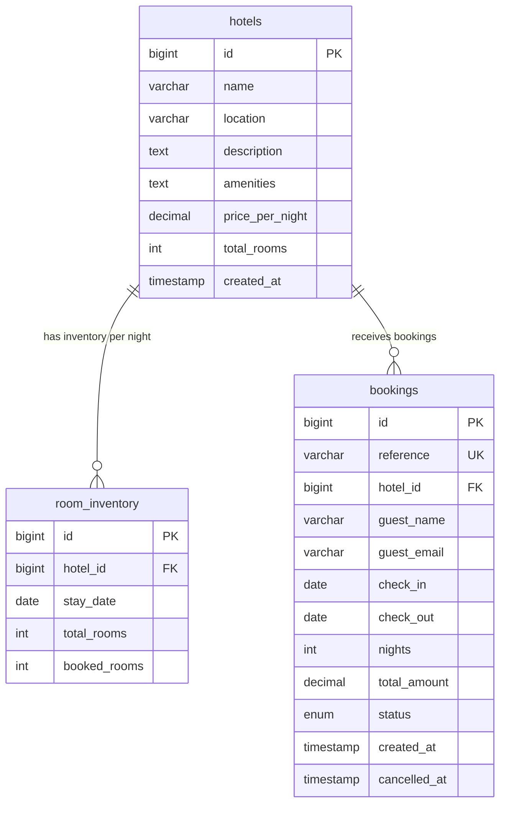
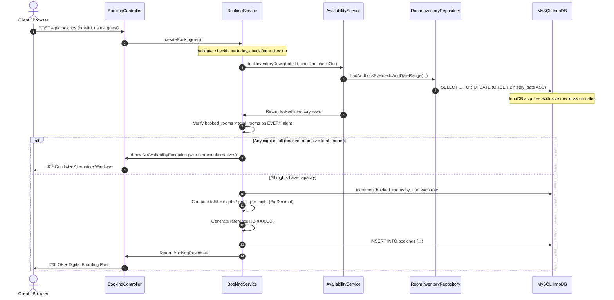

# System Design & Architecture Document
## Hotel Booking Portal — System Architecture & Specification

---

## 1. Architecture Overview

The system is organized as a unified monorepo divided into two decoupled layers:

```
├── backend/    # Spring Boot 3, Java 17, JPA, MySQL, Flyway
├── frontend/   # React 19, Vite, Axios, Plain CSS Design System
├── db/         # Direct SQL schema and seed mirrors (for manual DBA setup)
└── docs/       # Screenshots & design artifacts
```

### Backend Layered Architecture
The backend strictly adheres to standard Spring Clean Layering:
1. **Controllers (`/controller`)**: HTTP transport mapping, JSON serialization, delegating to services, input validation triggers (`@Valid`).
2. **Services (`/service`)**: Domain business logic, transaction boundaries (`@Transactional`), pessimistic locking, price calculations using `BigDecimal`.
3. **Repositories (`/repository`)**: Spring Data JPA repositories with explicit SQL / JPQL lock hints (`@Lock(LockModeType.PESSIMISTIC_WRITE)`).
4. **Entities (`/entity`)**: Relational database entities mapping tables with integrity constraints.
5. **DTOs (`/dto`)**: Pure decoupled request and response contracts isolating domain models from API consumers.
6. **Exception Handlers (`/exception`)**: Central `@RestControllerAdvice` converting all domain exceptions to uniform error shapes without leaking internal stack traces.

---

## 2. Database Design

The relational schema is intentionally minimal, normalized, and enforced by database constraints in MySQL 8:



### Key Relational Rules & Constraints
1. **Per-Night Inventory Model (`room_inventory`)**:
   - `UNIQUE KEY uq_hotel_date (hotel_id, stay_date)`: Guarantees that each hotel has at most one inventory tracking record per calendar night.
   - `CONSTRAINT chk_booked_rooms CHECK (booked_rooms >= 0 AND booked_rooms <= total_rooms)`: Enforced directly by MySQL 8's InnoDB engine as a last-line database safety net against overbooking.
2. **Date Interval Convention**:
   - Stays are defined as the half-open interval `[checkIn, checkOut)`.
   - A guest checking in on Friday and checking out on Sunday occupies **Friday night** and **Saturday night** (2 nights). **Sunday (check-out day) is not occupied** and is immediately available for the next guest's check-in.
3. **Pre-Seeded & Lazy Inventory Creation**:
   - The Flyway migration `V2__seed.sql` seeds 120 days of nightly inventory for all 6 hotels.
   - For dates beyond the seeded range, `AvailabilityService.ensureInventoryExists` lazily inserts missing calendar rows inside the active transaction with `total_rooms = hotel.total_rooms` and `booked_rooms = 0`.

---

## 3. Booking Logic & Concurrency Control

### Booking Lifecycle Flow



### Race Condition & The "Last Room" Problem
When a boutique property (such as *The Papier House*, which has only 2 rooms) has only 1 room remaining, two guests submitting booking requests at the exact same millisecond must not both receive confirmation.

1. **Pessimistic Locking (`SELECT ... FOR UPDATE`)**:
   - `RoomInventoryRepository.findAndLockByHotelIdAndDateRange` executes a pessimistic write lock:
     ```sql
     SELECT r FROM RoomInventory r 
     WHERE r.hotelId = :hotelId 
       AND r.stayDate >= :checkIn 
       AND r.stayDate < :checkOut 
     ORDER BY r.stayDate
     ```
   - Transaction A locks the rows for the contested nights.
   - Transaction B attempting to book the same room blocks at the database level until Transaction A commits or rolls back.
   - When Transaction A commits, `booked_rooms` has been incremented to `total_rooms`.
   - Transaction B awakens, reads the updated rows, observes `booked_rooms >= total_rooms`, and immediately throws `NoAvailabilityException` (HTTP 409).
2. **Deadlock Prevention**:
   - All locks on `room_inventory` rows are explicitly ordered by `stay_date ASC`. Because all concurrent transactions acquire row locks in the exact same chronological sequence, circular wait conditions (deadlocks) are mathematically eliminated.
3. **Database-Level CHECK Constraint**:
   - Even in the event of an application software bug or direct SQL execution, MySQL's `CHECK (booked_rooms <= total_rooms)` prevents overbooking at the storage engine level.

---

## 4. Design Decisions & Trade-Offs

| Decision | Chosen Approach | Alternative Considered | Trade-Off & Rationale |
|---|---|---|---|
| **Inventory Tracking** | Per-night row model (`room_inventory`) | Overlap query against `bookings` table (`NOT EXISTS (SELECT ... WHERE checkIn < :out AND checkOut > :in)`) | Overlap queries require range locking large portions of the booking table, make room quantity math complex, and fail under multi-room scenarios. Per-night rows allow row-level locks on exact dates and straightforward capacity adjustments. |
| **Concurrency Locking** | Pessimistic Locking (`PESSIMISTIC_WRITE`) | Optimistic Locking (`@Version` column) | In hotel reservations, the "last room" is a high-contention resource. Under optimistic locking, the loser would fail on commit and need client retries after user expectation was set. Pessimistic locking guarantees immediate, deterministic queueing and serial execution. |
| **Monetary Math** | `BigDecimal` throughout backend | `double` / `float` | Floating point arithmetic introduces binary rounding errors (e.g., `0.1 + 0.2 = 0.30000000000000004`). In financial transactions, exact arbitrary-precision `BigDecimal` is mandatory. |
| **Unique Reference** | `HB-` + 6 random alphanumeric characters (`SecureRandom`) | Sequential auto-increment ID or UUID v4 | Sequential IDs leak business volume to competitors. UUIDs (36 characters) are unwieldy for guests to read or copy. A cryptographically random 6-character code yields $36^6 \approx 2.17 \times 10^9$ combinations, perfect for human readability and collision resilience. |

---

## 5. Alternative Dates Recommendation Engine

### Problem Statement
When a guest searches for dates that are fully booked, traditional portals display an unhelpful dead-end: *"No rooms available"*. This leads to immediate customer bounce.

### Solution
When `BookingService` or the availability search detects that a hotel is sold out for the requested window, `NearestDatesService.findAlternatives` automatically slides a window of `N` nights across a $\pm 14$-day horizon:
1. Clamps window start to `LocalDate.now()` to guarantee no past dates are suggested.
2. Excludes the requested sold-out dates.
3. Checks nightly capacity across candidate windows using the pre-fetched inventory map.
4. Computes the exact folio total for each valid window using `BigDecimal`.
5. Returns up to **3 alternative windows**, returned in the 409 response payload.
6. The frontend displays these as clickable **"Ticket Stubs"** that re-populate the date picker with one click and refresh the live quote.

---

## 6. UI / UX Design Rationale

### Concept: "Editorial Travel Journal"
The user interface avoids conventional corporate template clichés (glassmorphism, gradient blob heroes, purple accents, emoji icons, card grids). Instead, it evokes the quiet authority of a print magazine:
- **Warm Paper & Deep Ink**: `#F6F1E9` background with `#16130F` text creates high-contrast readability without harsh pure white glare.
- **Single Bold Accent**: Terracotta / burnt vermilion (`#E4572E`) is used exclusively for primary actions and financial metrics.
- **Typography Scale**:
  - Headings: *Fraunces* (characterful display serif with tight letter-spacing).
  - Body & UI: *DM Sans* (neutral grotesk).
  - Prices & Codes: *DM Mono* (tabular numbers for vertical price alignment).
- **Sentence-Style Search**: On the home page, the search input is presented as an editable typographic sentence (*"I am travelling to [City] from [Date] to [Date]"*), turning a sterile form into an invitation.
- **Boarding Pass Ticket**: Reservations, folios, and quotes are rendered with perforated edges (CSS cutout notches and dash lines) and monospace metadata, reinforcing the travel aesthetic.
- **Generative Hotel Identities**: Rather than generic stock photos, each hotel is rendered with a deterministic abstract architectural SVG (`HotelVisual.jsx`) computed from the property's name, city, and ID.

---

## 7. Known Limitations & Production Enhancements

1. **Distributed Architecture**: For multi-node microservices, database row locks should be supplemented with distributed Redis locks (e.g., Redisson) for horizontal scalability.
2. **Multi-Room Bookings**: Current scope supports booking 1 room per reservation. Multi-room bookings would require an integer `rooms_requested` field and matching capacity checks.
3. **Authentication & Payments**: Designed as an interview prototype without authentication or payment gateways. In production, integrate Spring Security with JWT/OAuth2 and Stripe/Razorpay webhooks before status changes to `CONFIRMED`.

